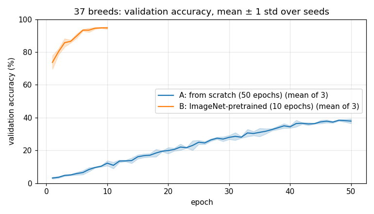
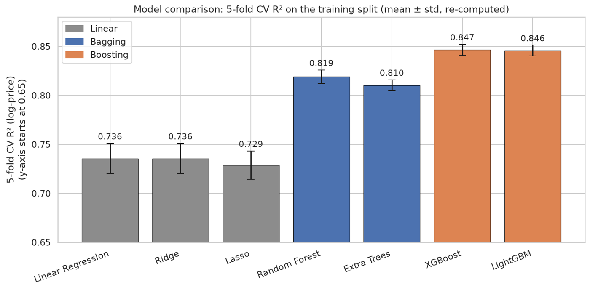

<picture>
  <source media="(prefers-color-scheme: dark)" srcset="https://raw.githubusercontent.com/bzaat/bzaat/main/assets/banner-dark-arts.svg">
  
</picture>

  
  
  
  
   
  
  

## About me

I'm an AI undergraduate at FPT University, Ho Chi Minh City (B.Sc. Artificial Intelligence, expected May 2028), working on **computer vision** and **uncertainty-aware perception**. I like building models from the ground up to find out what actually makes them work: a ResNet-50 written layer by layer, a badminton analytics pipeline evaluated leave-one-match-out, and evidential deep learning that decides when a rescue drone should take a closer look.

- **Now:** sports video analytics (badminton detection and shot understanding)
- **Next:** Vision Transformers, and deploying models with ONNX/TensorRT
- **Long term:** embodied AI, vision-language-action (VLA) models, world models
- **Open to:** AI / deep learning internships, Feb–Apr 2027 (11-week OJT, Malaysia)

## Publications

<table>
<tr>
<td width="68%" valign="top">

**[The Impact of Suburb-Level Encoding on Melbourne Housing Price Prediction](https://github.com/bzaat/Real-Estate-Price-Analysis/blob/main/Realestate%20(3).pdf)** 
SCI-2026, 8th Int. Conf. on Smart Computing and Informatics · **First author** (1 of 5) · Accepted / under publication 
Presented 28–29 April 2026, Swinburne Vietnam, Hanoi

XGBoost and LightGBM reached R² = 0.843 (log-price, 5-fold CV). Suburb encoding raised Random Forest test R² from 0.815 to 0.835; with shuffled suburb labels it fell to 0.810, so the gain is real locality signal.

[Paper](https://github.com/bzaat/Real-Estate-Price-Analysis/blob/main/Realestate%20(3).pdf) · [Code](https://github.com/bzaat/Real-Estate-Price-Analysis) · [Certificate](docs/SCI-2026_Certificate_of_Appreciation.pdf)

</td>
<td width="32%" valign="top">

</td>
</tr>
<tr>
<td colspan="2" valign="top">

**[Uncertainty-Triggered Active Sensing for UAV Maritime Rescue Prioritization under Wave Occlusion](https://drive.google.com/file/d/1FCH_cXJ0TVkZ_ojBMmjDJuSu9dBFo4y0/view?usp=sharing)** 
IECON 2026 · **Third author** (3 of 4) · Accepted / under publication

In simulation (500 Monte Carlo trials, evidential perception proxy), versus a distance-based router: worst-case survival 0.25 vs 0.16, catastrophic failures 67% vs 83%, false-alarm visits 35.0% vs 60.5%. Results against deterministic expected-risk routing are mixed, because verification descents add latency.

[Paper](https://drive.google.com/file/d/1FCH_cXJ0TVkZ_ojBMmjDJuSu9dBFo4y0/view?usp=sharing) · [Code](https://github.com/nguyentrinhquy1411/DAP391m-SU26) · [Live demo](https://nguyentrinhquy1411-dap391m-su26-app-f0wroj.streamlit.app/)

</td>
</tr>
</table>

## Featured projects

### [ResNet-50 Image Classification (PyTorch)](https://github.com/bzaat/pytorch-resnet50v1-implementation)
ResNet-50 built manually with `torch.nn`, used to compare **training from scratch vs. transfer learning** on the Oxford-IIIT Pet dataset (37 breeds, ~3.7k images).

| Setup | Epochs | Test accuracy (mean ± std, 3 seeds) |
|---|---|---|
| ResNet-50 from scratch, 37 breeds | 50 | 32.0 ± 1.1% |
| ImageNet-pretrained, fine-tuned (layer4 + new head), 37 breeds | 10 | **92.4 ± 0.3%** |
| ImageNet-pretrained, fine-tuned, cat vs dog | 10 | 99.7 ± 0.1% |

<table>
<tr>
<td width="50%"></td>
<td width="50%"></td>
</tr>
<tr>
<td>Validation accuracy, mean ± std over 3 seeds.</td>
<td>Pretrained model, test confusion matrix (seed 42). Most errors are between similar breeds.</td>
</tr>
</table>

The checkpoint is chosen on a held-out validation split (20% of trainval); the official test split is evaluated only once, after training.
Takeaway: the from-scratch model reaches 73% train accuracy but only 32% on test, so it overfits the small dataset, while a pretrained backbone reaches high accuracy in a few epochs.
Also includes: custom Dataset, augmentation, cosine LR with weight decay, TensorBoard logging, resumable checkpoints (with RNG state), multi-seed aggregation scripts, `uv` setup and a Dockerfile.

**Stack:** PyTorch · Transfer Learning · Computer Vision

### [Melbourne Housing Price Prediction](https://github.com/bzaat/Real-Estate-Price-Analysis)
Comparison of 7 regression models with suburb-level encoding. XGBoost and LightGBM reached R² = 0.843 (log-price, 5-fold CV); suburb encoding raised Random Forest test R² from 0.815 to 0.835, checked with a shuffled-suburb control and SHAP.

<table>
<tr>
<td width="50%"></td>
<td width="50%"></td>
</tr>
<tr>
<td>5-fold CV R² of the 7 models (re-computed from the repo code).</td>
<td>Random Forest without / with / shuffled suburb (re-computed; the paper reports 0.815 / 0.835 / 0.810 test R²).</td>
</tr>
</table>

**Stack:** Python · Scikit-learn · XGBoost · LightGBM · SHAP

### [Badminton Singles Analytics](https://github.com/bzaat/Badminton_Project) (in progress)
Hit detection, shot-type classification and court-space movement features on 12 professional singles matches (BFMD dataset), evaluated leave-one-match-out. Hit detection F1 0.736 (±2 frames); shot-type macro F1 0.707 over 12 classes (majority baseline 0.034). A Faster R-CNN detector for players and the shuttle is the next stage. Project showcase: [bzaat.github.io/Badminton_Project](https://bzaat.github.io/Badminton_Project/).

**Stack:** Python · OpenCV · Scikit-learn · PyTorch

## Skills

- **Core areas:** Machine Learning, Deep Learning, Computer Vision, Predictive Modeling, Data Analysis
- **Languages:** Python, C (basic), SQL, LaTeX
- **Tools:** PyTorch, Scikit-learn, OpenCV, Git/GitHub, Linux, Bash, uv, Docker
- **Spoken languages:** Vietnamese (native), English (professional working proficiency)

## Lab activity

AITA Lab reading group on federated learning (10/2025–02/2026): reviewed and presented papers.

## Contact

Portfolio: [bzaat.github.io/bzaat](https://bzaat.github.io/bzaat/) · Email: nguyentvvn12@gmail.com · [LinkedIn](https://www.linkedin.com/in/khanh-nguyen-pham-nguyen-7b822b371) · Ho Chi Minh City, Vietnam
