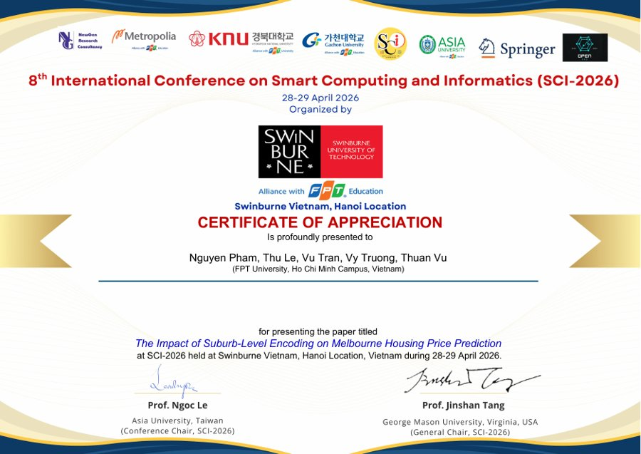
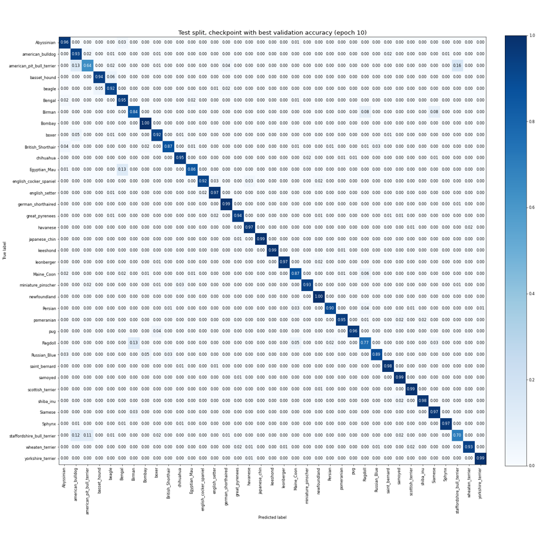
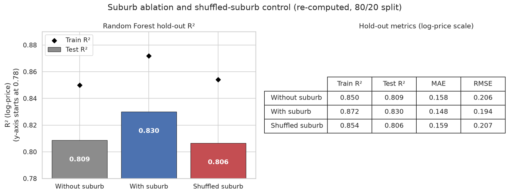

<picture>
  <source media="(prefers-color-scheme: dark)" srcset="assets/banner-dark-arts.svg">
  
</picture>

  
  
  
  
   
  
  

## The wizard behind the wand

I'm an AI undergraduate at FPT University, Ho Chi Minh City (B.Sc. Artificial Intelligence, expected May 2028), working on **computer vision** and **uncertainty-aware perception**. I like building models from the ground up to find out what actually makes them work: a ResNet-50 written layer by layer, a badminton analytics pipeline evaluated leave-one-match-out, and evidential deep learning that decides when a rescue drone should take a closer look.

- **Now:** sports video analytics (badminton detection and shot understanding)
- **Next:** Vision Transformers, and deploying models with ONNX/TensorRT
- **Long term:** embodied AI, vision-language-action (VLA) models, world models
- **Open to:** AI / deep learning internships, Feb–Apr 2027 (11-week OJT, Malaysia)

## Spell of the Day & Ministry Records

  <picture>
    <source media="(prefers-color-scheme: dark)" srcset="assets/card-dark.svg">
    
  </picture>
  <picture>
    <source media="(prefers-color-scheme: dark)" srcset="assets/records-dark.svg">
    
  </picture>

  <picture>
    <source media="(prefers-color-scheme: dark)" srcset="https://streak-stats.demolab.com/?user=bzaat&hide_border=true&border_radius=14&background=0B0C10&stroke=1A472A&ring=2ECC71&fire=2ECC71&currStreakNum=C5C6C7&sideNums=C5C6C7&currStreakLabel=2ECC71&sideLabels=8F989E&dates=8F989E">
    
  </picture>

<picture>
  <source media="(prefers-color-scheme: dark)" srcset="https://raw.githubusercontent.com/bzaat/bzaat/output/snake-dark.svg">
  
</picture>

## Daily Prophet & Academic Scrolls

<table>
<tr>
<td width="68%" valign="top">

**[The Impact of Suburb-Level Encoding on Melbourne Housing Price Prediction](https://github.com/bzaat/Real-Estate-Price-Analysis/blob/main/Realestate%20(3).pdf)** 
SCI-2026, 8th Int. Conf. on Smart Computing and Informatics · **First author** (1 of 5) · Accepted / under publication 
Presented 28–29 April 2026, Swinburne Vietnam, Hanoi

XGBoost and LightGBM reached R² = 0.843 (log-price, 5-fold CV). Suburb encoding raised Random Forest test R² from 0.815 to 0.835; with shuffled suburb labels it fell to 0.810, so the gain is real locality signal.

[Paper](https://github.com/bzaat/Real-Estate-Price-Analysis/blob/main/Realestate%20(3).pdf) · [Code](https://github.com/bzaat/Real-Estate-Price-Analysis) · [Certificate](docs/SCI-2026_Certificate_of_Appreciation.pdf)

</td>
<td width="32%" valign="top">

</td>
</tr>
<tr>
<td colspan="2" valign="top">

**[Uncertainty-Triggered Active Sensing for UAV Maritime Rescue Prioritization under Wave Occlusion](https://drive.google.com/file/d/1FCH_cXJ0TVkZ_ojBMmjDJuSu9dBFo4y0/view?usp=sharing)** 
IECON 2026 · **Third author** (3 of 4) · Accepted / under publication

In simulation (500 Monte Carlo trials, evidential perception proxy), versus a distance-based router: worst-case survival 0.25 vs 0.16, catastrophic failures 67% vs 83%, false-alarm visits 35.0% vs 60.5%. Results against deterministic expected-risk routing are mixed, because verification descents add latency.

[Paper](https://drive.google.com/file/d/1FCH_cXJ0TVkZ_ojBMmjDJuSu9dBFo4y0/view?usp=sharing) · [Code](https://github.com/nguyentrinhquy1411/DAP391m-SU26) · [Live demo](https://nguyentrinhquy1411-dap391m-su26-app-f0wroj.streamlit.app/)

</td>
</tr>
</table>

## The Restricted Section

**[ResNet-50 from scratch vs. transfer learning](https://github.com/bzaat/pytorch-resnet50v1-implementation)** · PyTorch 
ResNet-50 written by hand with `torch.nn` and compared against an ImageNet-pretrained backbone on Oxford-IIIT Pet (37 breeds), with a held-out validation split, a test set used once, and 3 seeds. Test accuracy: **92.4 ± 0.3%** fine-tuned in 10 epochs vs **32.0 ± 1.1%** from scratch in 50 (73% train accuracy: it overfits ~3k images). Resumable checkpoints with RNG state, TensorBoard, `uv` and Docker.

**[Badminton singles analytics](https://github.com/bzaat/Badminton_Project)** · OpenCV, scikit-learn, PyTorch · *in progress* 
Hit detection, shot-type classification and court-space movement features on 12 professional matches (BFMD), evaluated leave-one-match-out: hit detection F1 0.737 (±2 frames), shot-type macro F1 0.710 over 12 classes (majority baseline 0.034). A Faster R-CNN detector for the players and the ~10 px shuttle is next.

**[Melbourne housing price prediction](https://github.com/bzaat/Real-Estate-Price-Analysis)** · scikit-learn, XGBoost, LightGBM, SHAP 
The code behind the SCI-2026 paper: 7 regression models, leakage-safe suburb target encoding, a shuffled-suburb control and SHAP attribution.

<b>Result figures</b>

 
<table>
<tr>
<td width="50%"></td>
<td width="50%"></td>
</tr>
<tr>
<td>ResNet-50: validation accuracy, mean ± std over 3 seeds.</td>
<td>Pretrained model, test confusion matrix (seed 42). Most errors are between similar breeds.</td>
</tr>
<tr>
<td width="50%"></td>
<td width="50%"></td>
</tr>
<tr>
<td>Melbourne: 5-fold CV R² of the 7 models (re-computed from the repo code).</td>
<td>Random Forest without / with / shuffled suburb (re-computed; the paper reports 0.815 / 0.835 / 0.810 test R²).</td>
</tr>
</table>

<b>🧳 Open Newt Scamander's Case (Fantastic Beasts Archive)</b>

 

| Creature | In the wild | In my work | Habitat (data) | Status |
|---|---|---|---|---|
| **Niffler** | Sniffs out small shiny things | Faster R-CNN detector for two players and a ~10 px shuttlecock | BFMD, 12 BWF singles matches | Being tracked |
| **Demiguise** | Sees the most probable future | Evidential deep learning: epistemic uncertainty triggers a verification descent | Monte Carlo maritime rescue simulation | Tamed, IECON 2026 |
| **Bowtruckle** | Small, built from twigs, guards its tree | ResNet-50 written layer by layer in PyTorch | Oxford-IIIT Pet, 37 breeds | Tamed, 92.4% fine-tuned |
| **Mooncalf** | Dances patterns into fields | Suburb-level target encoding with a shuffled control and SHAP | Melbourne housing, 10,480 sales | Tamed, SCI-2026 |
| **Occamy** | Grows to fill the space available | Vision Transformers | — | Expedition planned |
| **Thunderbird** | Senses danger and acts before it arrives | Embodied AI and VLA models: perception that turns into action | — | Expedition planned |

Tamed: published or shipped. Being tracked: in progress. Expedition planned: what I'm learning next.

## Wands, Potions & Magical Artifacts

**Wands** (languages) 

**Potions** (machine learning & vision) 

**Magical artifacts** (tools) 

Also: AITA Lab reading group on federated learning (10/2025–02/2026) · Vietnamese (native), English (professional working proficiency)

---

  <i>Mischief Managed.</i> 
  Owl Post: <a href="mailto:nguyentvvn12@gmail.com">nguyentvvn12@gmail.com</a> · <a href="https://www.linkedin.com/in/khanh-nguyen-pham-nguyen-7b822b371">LinkedIn</a> · <a href="https://bzaat.github.io/bzaat/">Portfolio</a> · Ho Chi Minh City, Vietnam

